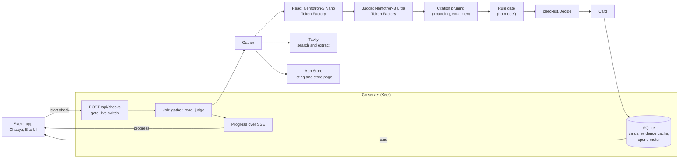

# Before Yes

Before Yes checks an app, game or YouTube channel for a parent before the child gets it. Enter the title and the child's age. It reads what the public sources say about contact, purchases, privacy, age limits, content and the developer's record, then returns a verdict for that age: **yes**, **yes with settings**, **no** or **unclear**. Every concern links to the source quote it rests on.

The hosted demo is at **https://beforeyes.nryn.dev**. Three demo cards open from the home page's "Previous checks" list. They are computed from recorded evidence, so opening them spends nothing:

| Title (age) | Verdict | What decides it |
|---|---|---|
| Roblox (9) | **no** | Concerns in purchases and content, each linked to its quote |
| Minecraft (9) | **yes with settings** | Three settings to turn on: Xbox "You can join multiplayer games" set to "Block", "Ask to Buy", and "Ask App Not to Track" |
| Khan Academy Kids (5) | **yes** | Five areas are OK; developer history has no evidence either way |

The cards are in [`testdata/demo-cards/`](testdata/demo-cards/). A test recomputes them from the recorded replies and fails if they differ.

## How Nemotron is used

Two NVIDIA Nemotron models do the reading and the judging. Both run on Nebius Token Factory, and the check calls no other model host.

**Nemotron-3 Nano (30B-A3B) reads every source.** Each gathered source is split into chunks. For each chunk Nano returns findings: a claim, the checklist area it belongs to, whether it is a risk, a control or neutral, the exact quote it rests on, and the source it came from. Thinking is off for this role, because Token Factory bills thinking as output. Nano does the high-volume work, so every source is read in full rather than sampled.

**Nemotron-3 Ultra (550B-A55B) judges.** It grades the six checklist areas from the verified findings. The first pass runs with thinking off. Where an area's findings pull both ways, a risk and a control for example, a second pass runs with thinking on, for those areas only. A failed second pass keeps the first-pass grades. Ultra also writes the parent-facing reason for each standing grade, and checks entailment (below). Ultra was chosen after trials of Nemotron-3.5 Lightning, Nemotron-3.5 Super-VL and Ultra on the same evidence. It was the first of them to reach the expected verdict on Khan Academy Kids without a rule override.

The sampling settings were needed because Ultra looped at temperature 0. Thinking calls use temperature 0.6, top_p 0.95 and repetition penalty 1.05. The first pass uses repetition penalty 1.1.

Why each model has its role: Nano is cheap enough to read everything, and the checklist needs that volume. Ultra makes the judgements, so it gets the most capable model.

After the model steps, these checks run. The model cannot skip any of them.

1. **Citation pruning.** A grade must cite verified findings from its own area. A bad citation id is removed. The grade stands while at least one verified, in-area citation remains. An "ok" grade with no citation becomes "not enough evidence".
2. **Grounding.** A finding survives only if its quote appears in the source text it names, after normalisation. This is a string match, not the model's word.
3. **Entailment.** For each concern or setting grade, Ultra (thinking off) answers two questions: do the cited findings meet the area's definition for this child's age, and does the grade's reason say only what the quotes support. A "no" makes the grade "not enough evidence". A failed call keeps the grade and records the failure.
4. **Rule gate.** Deterministic Go code, with no model call. It can veto, cap, confirm or raise a grade based on what the verified quotes say. Every action appears on the card in "About this check", under Rule checks, with the reason in plain words.
5. **Decide.** `checklist.Decide` turns the six grades into the verdict. The verdict is computed from the grades, not generated.

## Where Token Factory helped

- **One OpenAI-style client.** The model client talks to Token Factory through an OpenAI-style chat API. The host, model id, prices and rate limits are settings in `before-yes.toml`. Switching the judge is a settings change. The trials of Lightning, Super-VL and Ultra ran the judge alone, with the reader replayed so each judge saw the same evidence.
- **Measured cost per check.** Model spend per fresh check is about $0.11, measured in the next section.
- **Sampling switches.** Thinking is turned off per request with `chat_template_kwargs.enable_thinking`. Temperature, top_p and repetition penalty are sent per call and honoured.

### Feedback on Token Factory and the Nemotron models

These come from [`dev-diary/feedback.md`](dev-diary/feedback.md), where each entry gives the evidence.

- **Thinking is on by default and billed as output.** The same Nano prompt reported 183 output tokens with no switch and 4 with `enable_thinking` set to false. A default that matches non-reasoning requests, or a documented per-model default, would help.
- **Two thinking switches are ignored or break.** `reasoning.enabled` is ignored on Token Factory, and `reasoning_effort` set to `none` returns empty text. A client written for another host's switch leaves thinking on, without an error.
- **Model ids are case-sensitive.** `nvidia/NVIDIA-Nemotron-3-Nano-30B-A3B` works and the lowercase spelling returns 404. Four Nemotron ids use different casing and punctuation.
- **A timed-out call may be billed with no usage returned.** The client cannot record the cost of a cut call. Partial usage on a closed connection would fix it.
- **Nano repeats itself at volume.** One Khan Academy Kids reply held 84 findings, 37 of them exact repeats of earlier lines. The client removes repeats, but the model should not emit them.
- **Nano accepted entailment prompts it should have refused** on one Minecraft gather. That is why the entailment check runs on Ultra.

## Measurements

Each figure comes from a file in this repository. The offline replay reads the recorded replies in `testdata/eval/replies/` and makes no network call.

| Measurement | Value | Source |
|---|---|---|
| Model cost per fresh check, mean of nine checks (Nano and Ultra) | **$0.106976** (Roblox $0.116922, Minecraft $0.110137, Khan Academy Kids $0.093868) | `docs/budget.md`, "Current plan-6 figures" |
| Model cost per check on the demo recordings (gather 0) | Roblox $0.122457, Minecraft $0.109098, Khan Academy Kids $0.096363 | `docs/budget.md`, same table; the replay reproduces these |
| Ultra price used for the cost | $1.00 in, $3.00 out per million tokens, **assumed**: the host's model page did not show a price | `before-yes.toml.example`, `[judge]` comment; `docs/budget.md` |
| Nano price | $0.06 in, $0.24 out per million tokens | `before-yes.toml.example`, `[reader]` |
| Tavily credits per check | **8 to 10** (Roblox 9, 9, 9; Minecraft 8, 8, 8; Khan Academy Kids 9, 10, 10 on three gathers) | `docs/budget.md`, "Tavily pool" section; fixture-measured |
| Verified findings kept, gather 0 | Roblox **202**, Minecraft **279**, Khan Academy Kids **162** | Offline replay of `testdata/eval/replies/` |
| Quotes dropped, gather 0 | Roblox **117** of 319 raw findings (36.7%), Minecraft **155** of 434 (35.7%), Khan Academy Kids **62** of 224 (27.7%). Most drops are quotes not found in the source text | Offline replay, same run |
| Chunks read, gather 0 | Roblox 45 (1 failed), Minecraft 50 (1 failed), Khan Academy Kids 14 (0 failed) | Offline replay, same run |
| Replay agreement with expected results, gather 0 | 3 of 3 verdicts; 12 of 18 area grades; 3 of 16 decisive quotes found | Offline replay; the expected results are set in `tools/eval` |
| Verdicts on gathers 0, 1 and 2 (plan-6 re-record) | Roblox: no, no, no. Minecraft: yes with settings, unclear, unclear. Khan Academy Kids: yes, unclear, yes | `docs/budget.md`, "Verdicts after the re-record" |
| Text read per page | up to 60,000 characters | `internal/pipeline/gather.go`, `maxDocChars` |
| Spend ceilings | $20 of the $25 Token Factory credit (lifetime); 900 Tavily credits a month; 5 fresh checks per UTC day | `docs/budget.md`; `before-yes.toml.example`, `[budget]` |
| Checks the ceilings cover | 186 by the model ceiling at the mean cost; 90 a month by Tavily at 10 credits | `docs/budget.md`, "Checks the budget covers" |

Reproduce the replay with `go run ./tools/eval -models replay` from the repository root. It needs no keys.

## What it does

1. **Enter a title and the child's age.** Ages 3 to 17.
2. **Gather the public sources.** The App Store listing (price, age rating, privacy label, Kids category and advisories) and reviews from the store page. The publisher's privacy policy and terms of service. Reddit threads, parent forums, news and regulator coverage, rating pages, and the title's own parental-controls help pages. Each check runs eight Tavily searches, plus extracts. Apple's public review feed is tried first and falls back to the store page when it returns nothing, which it currently does.
3. **Read.** Nano turns each source into quoted findings. Findings whose quotes do not match the source are dropped.
4. **Judge.** Ultra grades the six areas for the child's age, then the checks above run.
5. **Read the card.** The verdict, the six areas, the settings to turn on, and each concern with its quotes under "Why this is a concern". "Read the source quotes" opens the quote and its source. "About this check" lists the sources, the findings excluded, the models used, the cost, and the rule checks.

The six areas, with the question the checklist asks of each (from `internal/checklist/checklist.go`):

| Area on the card | What it asks |
|---|---|
| Contact with strangers | Can strangers message or voice chat with the child? Is it on by default? Can it be turned off? |
| Purchases and spending | Does it push in-app purchases, loot boxes, pay-to-win or subscription traps? |
| Privacy and data | What does it collect? Does it track for ads or share with third parties? Can the data be deleted? |
| Age restrictions | Does the age gate work in practice, going by what parents report? |
| Content | What do reviewers actually report seeing? |
| Developer history | Has the developer had fines, breaches, lawsuits or regulatory actions? |

Each area gets one of four grades. **OK** means nothing in the evidence calls for action. **Needs a setting change** names the setting to turn on. **Concern** links to the quote that raised it. **Not enough evidence** means the sources do not settle the area.

The verdict follows from the grades:

- **no**: any area is a concern.
- **unclear**: contact or content has no evidence, or three or more areas have none. An unclear result says so instead of guessing.
- **yes with settings**: no concern, and at least one setting to turn on.
- **yes**: no concern and no setting needed.

Safer alternatives are part of the design. For a "no" or "yes with settings" card, the pipeline searches for other titles and runs a full check on each candidate. A candidate appears only if its verdict beats the original's. None of the three demo cards shows one.

## Why it isn't "just ask ChatGPT"

- **It reads the evidence.** It gathers the policy, the terms, store facts, reviews, forum threads and help pages, and reads them in chunks. A chat answer summarises the few pages a search returned.
- **Every claim is a verified quote.** A finding whose quote does not appear in its source is dropped before the judge sees it. A concern on the card links to that quote.
- **A deterministic gate checks the model.** The rule gate and the verdict rules are Go code. The model grades; the code decides the verdict and which grades the evidence can support.
- **The checklist is fixed.** The same six areas and rules apply to every title, so two cards can sit side by side.
- **An unclear result says so.** Missing evidence never reads as "yes".

It is a research aid, not a guarantee. The card shows its sources and when it was checked.

## Architecture



- **Front end.** A Svelte 5 app on Chaaya 0.4.2. It follows a check's progress over server-sent events, then opens the card at an unguessable URL.
- **Server.** One Go binary built with Keel. Keel provides the job runner (a check outlives its request), progress streaming with replay, the evidence and card caches, the spend meter with its daily cap, the passcode and rate-limit gate, the live switch, unguessable ids, and the error format.
- **Storage.** SQLite. Cards and job records sit in `before-yes.db`. The spend meter is in `spend.db`, which holds an exclusive lock so a second process cannot book against it.
- **Model client.** One OpenAI-style client for every model host. The Token Factory hosts and model ids are settings.

## Known limits

- **Verdicts change between gathers.** Minecraft and Khan Academy Kids moved between verdicts on live evidence (see Measurements). The expected verdicts were guesses made before the pipeline ran (`testdata/titles/README.md`).
- **Minecraft's contact grade is borderline.** Its cited quotes for contact and age gating are weaker than the card's reasons. The check accepted them. This is recorded in `dev-diary/feedback.md`.
- **No alternatives on the demo cards.** The alternatives step needs live checks, and the demo cards were built from recordings.
- **Apple's review feed returns no reviews now.** The store page gives three or four reviews per title, without ratings or dates.
- **Google Play is not read.** It has no official API, and scraping it is out of scope.
- **Every demo card is an iOS app.**

## Run it locally

You need:

- **Go** at the version in `go.mod` (1.27.1 or later).
- **Node 24 or later**, as `web/package.json` requires.
- **pnpm**. The Dockerfile pins 11.28.5.
- **Keys.** Token Factory (`NEBIUS_KEY`) and Tavily (`TAVILY_KEY`). See [`docs/keys.md`](docs/keys.md) for where to create them. Keep them in a `.env` file in the repository root, mode `0600`. Never commit it.

Then, from the repository root:

```sh
# 1. Build the web app. The server serves web/build.
pnpm --dir web install --frozen-lockfile
pnpm --dir web build

# 2. Settings. Copy the example, then point the three [secrets.*] path
#    entries at your own .env. The example points at the author's machine.
cp before-yes.toml.example before-yes.toml

# 3. Build the binary.
go build -o before-yes ./cmd/before-yes

# 4. Load the three demo cards. Nothing is spent. Running it again changes nothing.
./before-yes seed-cards

# 5. Serve on 127.0.0.1:8090.
./before-yes serve

# 6. The gate: gofmt, go vet, go test -race, and the web lint, check and test scripts.
./tools/check.sh
```

Two things to know:

- `serve` reads `live` from `before-yes.toml`. With `live = true`, starting a check on a new title makes paid calls. Set `live = false` to browse the demo cards without spending.
- `./before-yes check "Roblox" -age 9` runs a full check and spends. The offline replay runs no check: `go run ./tools/eval -models replay`.

For a fresh clone, step 2 is the step most likely to fail. The `path` entries in `before-yes.toml.example` point at a file that will not exist on your machine.

## Deploying

The app ships as one container, built from the repository's `Dockerfile`, on a Hetzner host behind Traefik. The container holds the Go binary and the built web app. Its data is a Docker volume, and a nightly job runs `before-yes backup`. The host does no model work. Model, search and App Store calls go out from the container. The runbook, including the DNS record, the host key file and rollback, is [`deploy/README.md`](deploy/README.md).

## Dependencies

- **[Keel](https://github.com/nrynss/keel)** (`github.com/nrynss/keel` v0.7.3, Go). Apache-2.0. It provides the job, stream, cost, throttle, cache, gate, flag, config, id, wire and sqlite packages.
- **[Chaaya](https://github.com/nrynss/chaaya)** (`@nrynss/chaaya` 0.4.2, npm). Apache-2.0. It provides the job stream the progress page uses and the theme and accessibility tokens.

The versions are declared in [`go.mod`](go.mod) and [`web/package.json`](web/package.json).

## Licence

Apache License 2.0. The full text is in [`LICENSE`](LICENSE), copyright 2026 Narayan SS.
